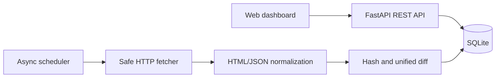

# DiffSignal

DiffSignal — self-hosted сервис для отслеживания содержательных изменений на веб-страницах. Он регулярно получает публичную страницу, удаляет визуальный шум, сохраняет нормализованные снимки в SQLite и показывает понятный текстовый diff через веб-интерфейс и REST API.

Подходит для наблюдения за документацией, changelog, ценами, расписаниями, вакансиями и страницами статуса.

## Возможности

- асинхронные проверки по расписанию и кнопка «Check now»;
- HTML, JSON, XML и обычный текст;
- CSS-селекторы для игнорирования рекламы, времени и динамических блоков;
- условные HTTP-запросы через `ETag` и `Last-Modified`;
- история снимков и unified diff;
- защита от SSRF: блокируются localhost, приватные, link-local и зарезервированные адреса, включая редиректы;
- ограничение размера ответа и разрешённых типов содержимого;
- REST API с документацией OpenAPI;
- адаптивная веб-панель без отдельного frontend build step;
- Docker и постоянный том для базы данных.

## Быстрый запуск

### Docker

```bash
git clone https://github.com/modeAlohadance/diffsignal.git
cd diffsignal
docker compose up --build
```

Откройте `http://localhost:8000`. Документация API доступна на `http://localhost:8000/docs`.

### Python

Требуется Python 3.11 или новее.

```bash
python -m venv .venv
# Windows: .venv\Scripts\activate
# Linux/macOS: source .venv/bin/activate
python -m pip install -e ".[dev]"
uvicorn diffsignal.api:app --reload
```

## Пример API

```bash
curl -X POST http://localhost:8000/api/monitors \
  -H "Content-Type: application/json" \
  -d '{"name":"Python releases","url":"https://www.python.org/downloads/","ignore_selector":".event-widget","interval_minutes":60}'

curl -X POST http://localhost:8000/api/monitors/1/check
curl http://localhost:8000/api/monitors/1/changes
```

Первая успешная проверка создаёт базовый снимок. Запись об изменении появляется только после того, как нормализованный текст действительно изменился.

## Архитектура



Сетевой слой проверяет адрес до каждого запроса и после каждого редиректа. Это снижает риск использования сервиса для доступа к внутренним адресам. Для открытого размещения в интернете всё равно следует добавить аутентификацию и ограничение частоты запросов.

## Настройки

| Переменная | По умолчанию | Назначение |
|---|---:|---|
| `DIFFSIGNAL_DATABASE_URL` | `sqlite+aiosqlite:///./diffsignal.db` | Подключение к базе |
| `DIFFSIGNAL_CHECK_LOOP_SECONDS` | `15` | Частота поиска просроченных проверок |
| `DIFFSIGNAL_MAX_RESPONSE_BYTES` | `2000000` | Максимальный размер страницы |
| `DIFFSIGNAL_DISABLE_WORKER` | `false` | Отключить фоновые проверки |

## Тесты

```bash
pytest -q
```

Тесты проверяют нормализацию HTML и JSON, CSS-исключения, формирование diff и блокировку внутренних сетевых адресов.

## Ограничения MVP

- сервис рассчитан на один экземпляр процесса;
- нет входа пользователей и уведомлений;
- страницы, полностью отрисовываемые JavaScript, не поддерживаются;
- SQLite подходит для личной установки и небольшой команды.

## License

[MIT](LICENSE)
